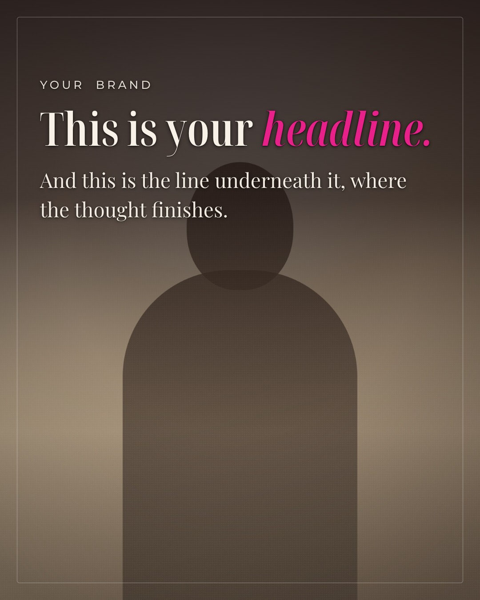

# Priestess Path Carousel

Make Instagram carousels that look like your brand, by talking to Claude Code.

You describe the slides. It handles the fonts, the colours, the crops, the
safe zones, and the part where somebody actually looks at every image before
you post it.



## What you need

- **Claude Code**
- **Node**, which you probably already have. If not, one installer from
  [nodejs.org](https://nodejs.org), double-clicked.

That is it. You will not type a single command. Claude runs all of them.

## Getting started

1. Download this folder. (Green **Code** button above, then **Download ZIP**,
   then unzip it somewhere you can find again, like Documents.)
2. Open that folder in Claude Code.
3. Say: **"set up my carousel skill"**
4. Say: **"set up my brand"**

Step 4 asks you three ways to define your look. Pick whichever is easiest:

- **Show me styles.** You see six and point at one. Ten seconds.
- **I'll show you what I like.** You drop in a few pictures you love, a Pinterest
  save, your website, another brand's post, and it matches the feeling.
- **I know my brand.** You have hex codes and font names and you hand them over.

It saves your answer. You are never asked again.

## Making a carousel

Say what you want. For example:

> Make me a 7 slide carousel about why nobody finishes their morning routine.
> Photos are in my downloads, the ones from the beach.

Claude will show you the photos it found so you can pick, write the slides,
render them, look at every single one, and then tell you where the files are.

Then you can say things like:

- "my head is cut off on slide 3"
- "make the pink deeper"
- "now make the story versions"

## What comes out

Real JPEGs at exactly 1080x1350, ready to post. Or 1080x1920 for stories,
or 1080x1080 for square. Not screenshots, not something you have to crop.

## The part that matters

Anything can generate a slide. The reason these look made rather than generated
is that every image gets looked at before you see it: heads not cut off, feet
not sliced, nothing important where Instagram puts its own buttons, the same
fonts on every slide, and the shadow sitting behind the text instead of
smothering the photo.

That checklist lives in [docs/verify.md](docs/verify.md) and it runs every time.

## If something breaks

[docs/troubleshooting.md](docs/troubleshooting.md). The most likely one is
"Could not find Chrome", which is one command and ten seconds, and Claude fixes
it without asking you.

## For the technically curious

```
brand/presets/     six starting styles, including the one this was built from
brand/setup.md     the three doors
templates/         the layout. one template, so slides cannot drift apart
scripts/           generate, screenshot, contact sheet, brand validator
docs/verify.md     the checklist
examples/          a working demo carousel with placeholder images
```

The images in `examples/` are generated placeholders, not photographs. Replace
them with your own.

## Licence

MIT. Use it, change it, make it yours.
